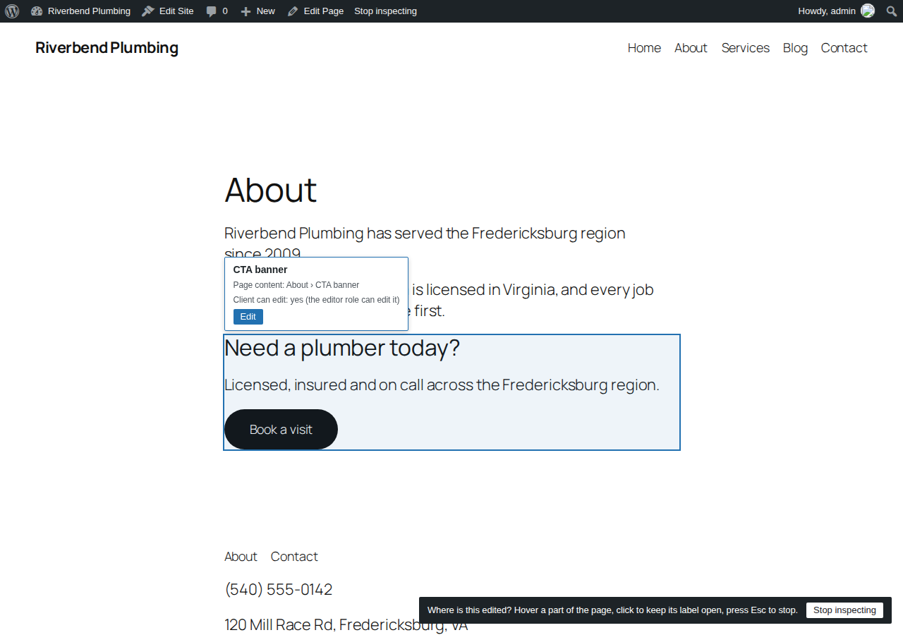
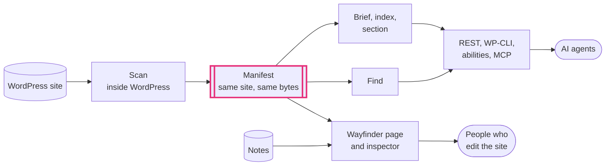

<div align="center">

<picture>
  <source media="(prefers-color-scheme: dark)" srcset="assets/readme/banner-dark.svg">
  <source media="(prefers-color-scheme: light)" srcset="assets/readme/banner-light.svg">
  
</picture>

<br>

[](https://github.com/voyager-marketing/voyager-wayfinder/actions/workflows/ci.yml)
[](LICENSE)
[](https://www.php.net/supported-versions.php)
[](https://wordpress.org/download/)
[](https://voyagermark.com)

**Wayfinder maps a WordPress site from the inside and tells you where each thing on it is edited.**<br>
One manual, two readers: the people who edit the site, in wp-admin, and the AI agents that help them.

[Try it in Playground](https://playground.wordpress.net/?blueprint-url=https://raw.githubusercontent.com/voyager-marketing/voyager-wayfinder/main/blueprint.json) &emsp; [What it does](#what-it-does) &emsp; [How it maps a site](#how-it-maps-a-site) &emsp; [Install](#install) &emsp; [Docs](#docs) &emsp; [Work with Voyager](#work-with-voyager)

</div>

## Who it's for

- **Site editors and site owners** who need to change a phone number, a banner or a menu and want the one screen where it lives, not a hunt through templates.
- **Agencies and developers** handing a site over, or picking one up, who need a current map of how it is built: post types and fields, templates and parts, patterns, menus, bindings and the plugins behind them.
- **AI agents** working on the site, which get the same map as compact, cache-stable text instead of crawling wp-admin.

> [!TIP]
> **Try it without installing anything.** [Open Wayfinder in WordPress Playground](https://playground.wordpress.net/?blueprint-url=https://raw.githubusercontent.com/voyager-marketing/voyager-wayfinder/main/blueprint.json). It builds a small demo site for a plumbing business, Riverbend Plumbing, and opens on the Wayfinder page, signed in as the admin. Everything runs in your browser and is gone when you close the tab.

## What it does

Wayfinder scans what WordPress already knows: post types, taxonomies and their fields, templates and template parts, patterns, menus, block bindings, which template renders each kind of URL, the active plugins, a short list of site settings, and the editor controls the theme turns off. It works on block themes and classic themes, ACF fields and options pages included. It writes the result to one deterministic manifest, and reads it out four ways.

**The manual in wp-admin.** The Wayfinder page lists everything the scan found in five sections: Site, Content, Layout, Routes and Integrations. Each item says what it is, what it uses, what uses it, whether a client in the editor role can change it, and links straight to its edit screen. Administrators pin notes to items, and a note is flagged for review when its item changes, so the manual does not quietly go stale.

**Where is this edited?** Give it a page and some text you can see on it, and it answers with the places that make up that part of the page, best match first, each with its edit screen. It keeps the first three and says how many more there are; `--detail=full` lists every one. Ask from WP-CLI, REST or an ability. On the demo site, this is the chain for the banner text on the home page:

```console
$ wp wayfinder find / --text="Need a plumber today?" --detail=full
```

| | Id | Where it is edited | Client can edit |
|---|---|---|---|
| **Match** | `pat:cta-banner` | Synced pattern "CTA banner": one edit changes both pages that use it. `post.php?post=4` | yes |
| | `pt:page` | The content of the page "Home". `post.php?post=5` | yes |
| | `tpl:page` | The "Pages" template, in the Site Editor | no: needs `edit_theme_options` |
| | `route:front-page` | The front page setting, Settings > Reading | no: needs `manage_options` |

**The inspector.** On the front end, "Where is this edited?" in the admin bar labels each part of the page with where it is edited, and links to that screen.

<p align="center"></p>

**Context for AI agents.** The same manual comes in three tiers, so an agent fetches only what it needs: a **brief** small enough to send with every request, an **index** with every item on one line, and a **section** with full detail as JSON. The same site gives the same bytes every time, and an agent that holds a manifest hash can ask what changed since. Every tier and the edit lookup are served over REST, WP-CLI and read-only WordPress abilities, which the MCP Adapter can share with AI tools once an administrator turns that on.

<details>
<summary>The demo site's brief, as an agent reads it</summary>

```text
# wayfinder v1 brief h:2dd3ef
site: Riverbend Plumbing | WordPress 7.1.4 | theme twentytwentyfive | front page home | posts page blog | permalinks /%postname%/
content: Services 1-5 (duration, price_from) | Media 0 | Pages 1-5 (footnotes) | Posts 1-5 (footnotes)
terms: Service areas 1-5 (on service) | Categories 1-5 (on post)
layout: 8 templates | 7 parts | 16 patterns | 1 menu
locks: part:header, part:footer: not locked at the edit path, content only inside a template (WordPress 7 default)
plugins: voyager-wayfinder (other)
gates: default palette off, appearanceTools on
edit: pt:service | Services | 1-5 published | edit.php?post_type=service
edit: part:footer | Footer | area footer; editor cannot open: needs edit_theme_options | site-editor.php?p=/wp_template_part/twentytwentyfive//footer&canvas=edit
edit: part:header | Header | area header; editor cannot open: needs edit_theme_options | site-editor.php?p=/wp_template_part/twentytwentyfive//header&canvas=edit
edit: pat:cta-banner | CTA banner | synced, used 1-5 times, one edit changes all | post.php?post=4&action=edit
edit: nav:primary | Primary | editor cannot open: needs edit_theme_options | site-editor.php?p=/wp_navigation/14
notes: none
more: index (every item, one line each) | section <section or item id> (full JSON; sections code, content_model, integrations, layout, routes, site) | changes since <hash> (changed ids)
```

The format, byte for byte, is in [docs/ai-context-format.md](docs/ai-context-format.md).

</details>

> [!NOTE]
> **Wayfinder only reads.** It never changes the site it maps: its only writes are its own manifest, snapshots and notes. It makes no external requests and calls no AI service, and the scan and its output are plain code. Every read needs a signed-in user who can edit pages, MCP sharing is off until an administrator turns it on, and it never outputs user emails, credentials, absolute server paths, or option values outside a short allowlist.

## How it maps a site



One scanner per section reads what WordPress registered: `site`, `content_model`, `layout`, `routes`, `code` and `integrations`. Each reads WordPress through a small interface, so the unit suite runs with no database. A theme switch, a plugin activation, a template save or an ACF field group save marks the manifest stale, and the next admin request scans again. The manifest body holds no timestamps, random ids or translated strings, and its hash covers the body alone, so an agent can cache what it fetched and REST answers carry an ETag.

## What the benchmark shows

The benchmark in [`bench/`](bench/README.md) puts the same questions about a seeded site to an AI agent with and without Wayfinder, against the standard WordPress MCP Adapter as the baseline, and grades each answer against an answer key the scanner never wrote.

- **On the seeded fixtures**, Claude Haiku 4.5 with the manual answered 97.5% of the block theme questions and 92.2% of the classic theme questions, against 54.2% and 48.9% through the MCP Adapter alone. It read 3.7 times fewer input tokens on the block site. Sonnet 5 gained less: 94.2% against 88.3% on the block site, short of the 10 point gain the run set out to show. Source: [run 3 summary](bench/reports/run3-summary.md), 2026-10-03.
- **On questions held out from every product fix**, the map still lifted the same agent: Haiku answered 30.0 points more of the held-out block set with the manual than without it (95% interval +12.2 to +48.9). It missed the accuracy floors the run set, and the summary lists each claim it failed. Source: [run 5 summary](bench/reports/run5-summary.md), 2026-10-06.

Every figure is recomputed from the committed reports, and [`bench/REPRODUCE.md`](bench/REPRODUCE.md) reruns the benchmark from a clean clone with your own API key.

## Install

Wayfinder needs **PHP 8.1+** and **WordPress 6.9+**, for the Abilities API in core. A WordPress.org listing is a later decision, so for now you upload the plugin ZIP by hand: Plugins > Add New Plugin > Upload Plugin.

- **A release.** From the first `v*` tag on, each release publishes `voyager-wayfinder.zip` on the [Releases](https://github.com/voyager-marketing/voyager-wayfinder/releases) page. No plugin release has been published yet.
- **A CI build.** Every pull request and every push to `main` builds the same ZIP as the `voyager-wayfinder` artifact of its [CI run](https://github.com/voyager-marketing/voyager-wayfinder/actions/workflows/ci.yml). GitHub keeps it for 14 days, and you need to be signed in to GitHub to download it.
- **Your own build.** Clone the repo, run `composer install --no-dev`, and zip the plugin as the `build-zip` job in `.github/workflows/ci.yml` does, or run the local site in [CONTRIBUTING.md](CONTRIBUTING.md#set-up).

Then open **Wayfinder** in the admin menu. The first visit scans the site. To share the manual with AI tools over MCP, install the [MCP Adapter](https://github.com/WordPress/mcp-adapter) plugin and tick "Share the manual with AI tools over MCP" in the Settings panel on the Wayfinder page.

The slug is `voyager-wayfinder` and the display name is "Voyager Wayfinder". The bare `wayfinder` slug on WordPress.org belongs to an unrelated block editor plugin, so it is not used here.

<details>
<summary>Commands and endpoints</summary>

| | Brief and index | Section | Where is this edited | Changes since a hash |
|---|---|---|---|---|
| WP-CLI | `wp wayfinder context --tier=brief` | `wp wayfinder context --tier=section --id=<id>` | `wp wayfinder find <url> --text=<text>` | `wp wayfinder diff`, against the stored scan |
| REST, `wayfinder/v1` | `GET /context?tier=brief` | `GET /context?tier=section&id=<id>` | `GET /find?url=<url>&text=<text>` | `GET /changes?since=<hash>` |
| Abilities, `voyager-wayfinder/` | `get-brief`, `get-index` | `get-section` | `find-edit-location` | `get-changes-since` |
| MCP resources | `wayfinder://brief`, `wayfinder://index` | | | |

`wp wayfinder scan --refresh` rescans and stores the result, `wp wayfinder export --format=md` writes the handoff manual, and `wp wayfinder notes` works with the notes. Every read needs the `edit_pages` capability. The reference for each surface is in [docs/ai-context-format.md](docs/ai-context-format.md).

</details>

<details>
<summary>Run Playground from a clone</summary>

The Playground link above installs the plugin from this repository's `main` branch. To try your own build in a throwaway site instead, use the [Playground CLI](https://wordpress.github.io/wordpress-playground/developers/local-development/wp-playground-cli) from a clone:

1. Unzip a build so the plugin sits in `build/voyager-wayfinder`.
2. Copy `blueprint.json` to `playground.json`, and delete its first four steps, which install the plugin from GitHub and activate it, so the blueprint starts at `setSiteOptions`. Add `{"step": "activatePlugin", "pluginPath": "voyager-wayfinder/voyager-wayfinder.php"}` as its first step.
3. Start it, mounting the build as the plugin:

   ```
   npx @wp-playground/cli server --blueprint=playground.json --mount-dir "$PWD/build/voyager-wayfinder" /wordpress/wp-content/plugins/voyager-wayfinder
   ```

It prints the local address, port 9400 by default. The site lands on the Wayfinder page, signed in as the admin. The blueprint seeds its own demo site; it never runs the benchmark's fixture seed.

</details>

## Docs

- [AI context format](docs/ai-context-format.md): what Wayfinder hands to agents, byte for byte
- [Contributing](CONTRIBUTING.md): set up, tests, scope and how decisions are made
- [Good first issues](docs/good-first-issues.md), builder sections first
- [Benchmark](bench/README.md) and [how to reproduce it](bench/REPRODUCE.md)
- [Security policy](SECURITY.md): report vulnerabilities privately
- [Code of conduct](CODE_OF_CONDUCT.md)
- [AGENTS.md](AGENTS.md): the contract for AI coding agents working in this repo

## Support

Issues are answered within two business days. Support hours are Monday to Friday, 9am to 5pm US Eastern time, outside US public holidays. Releases ship in batches every two weeks. Questions, bugs and feature requests all go to [issues](https://github.com/voyager-marketing/voyager-wayfinder/issues/new/choose).

Builder-specific sections (Bricks, Beaver Themer, Divi Theme Builder and others) are left to contributors. See [CONTRIBUTING.md](CONTRIBUTING.md#support-window-and-releases).

## Work with Voyager

Voyager is a WordPress and SEO agency that builds sites AI agents can work on safely, and then runs them. Wayfinder comes out of that work, and so does its sibling, [Voyager Open Blocks](https://github.com/voyager-marketing/voyager-open-blocks): agent-ready page sections that read your business details from one settings screen. Both are free under the GPL. To have Voyager build or run your site, [talk to Voyager about your site](https://voyagermark.com).

## License

GPL-2.0-or-later. See [LICENSE](LICENSE). "Voyager" and "Voyager Wayfinder" are Voyager Marketing's names; the license covers the code, not the names.
